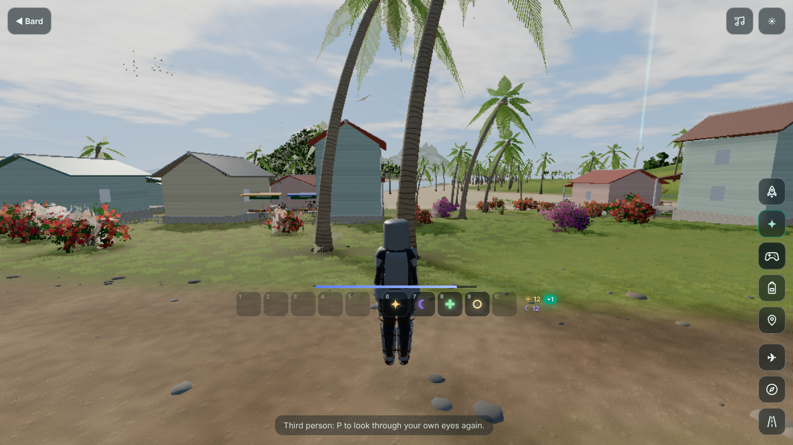

# Armour and combat gear, worn and seen (2026-10-17)

What you wear now shows on your body: you see it in third person, on your own arms in first person, and on your
friends in a shared room. There are five slots, head to foot: **Head**, **Top**, **Legs**, **Hands** and **Feet**.
The militia were also re-kitted the way soldiers dress today.

## The pieces

There are 29 garments in `island/src/gameplay/arms.js` (19 are new). Each one's look is in
`island/src/people/armor-looks.js`.

| Slot | Aether | The old kingdoms | Modern |
| --- | --- | --- | --- |
| Head | Wayfarer's Hood, Stargazer Circlet | Kettle Helm (wide brim), Great Helm (closed, eye slit, brass cross) | Ops Cap with headset, Ballistic Helmet (high cut, night-vision mount, headset) |
| Top | Aetherweave Coat, Ranger's Jacket | Gambeson (quilted), Mail Hauberk, Plate Cuirass (breast and back plate, fauld, pauldrons) | Combat Shirt, Chest Rig, Plate Carrier |
| Legs | Aetherweave Trousers, Ranger's Trousers | Mail Chausses, Plate Greaves (cuisses, knee cops, greaves) | Combat Trousers with knee pads |
| Hands | Spellbinder Gloves, Fieldcraft Gloves | Plate Gauntlets, Leather Bracers | Tactical Gloves (knuckle guard) |
| Feet | Trailstrider Boots, Duskwalker Boots | Sabatons, Riding Boots | Combat Boots (coyote) |

Modern gear is multicam, with no real makers, insignia or unit marks.

## What it does

The stats for each piece are in `gear-levels.js` STATS. `composeMods` (`magic/stats.js`) folds them into
`state.mods`.

- **Armour**: each piece takes a share of the damage you take. The share grows with the item's level, up to its
  cap. The total is capped at 60%.
- **Weight**: you carry 8 kg for free. Each kilogram over that makes you 1% slower and lowers your jump. The most
  weight can slow you is 30%.
- **Steel and spells**: steel lowers the power of every spell (Spellcraft, shown as −N%).
  - A full knight's kit is 27 kg, so you move 19% slower, and your spells lose 21%.
  - Modern gear has no spell penalty and is light: a plate carrier is 9 kg for 14% armour.
- **Where it shows**:
  - the Character sheet has a Load line;
  - the skills menu shows steel as a red `−N%` chip in each spell's power sources.

## How it is drawn

`dressInGear(style, worn)` lays each worn piece over the clothes you already have on. Each slot replaces only its
own part: a helm takes the place of a cap, and trousers take the place of trousers.

The pieces are built in `people/garment.js` `accessoryGeometry`:

- **Gloves and gauntlets** are the hand's own skin pushed a few millimetres out. They use the skin's own bone
  weights, so they bend with every finger.
  - Gauntlets add a flared steel cuff and a raised ridge over the knuckles.
  - Combat gloves add a knuckle guard and a wrist strap.
  - Bracers add a long laced cuff.
- **Plate on the limbs** follows the bone.
  - The cuisses, greaves, gauntlet cuffs and pauldron lames are measured against the skin and the trousers there,
    and tapered to fit.
  - Pauldrons are a cap and three lapping lames.
- **Steel** is kit gloss 3 (`propkit.js`). It is part metal, so it stays grey in a world with no reflections. With
  full metal it rendered black.

When your gear changes, the avatar rebuilds your body in place. The first-person arms rebuild from the new body.

**Multiplayer**: the pose carries `wr`, a short wear code. `net/protocol.js` checks it, and `net/remotes.js`
rebuilds a friend's body when it changes. **The rooms Worker must be redeployed for friends to see your gear.**

## The militia

- **Militia**, in `combat/outfits.js` `militia()`:
  - Two in three wear modern kit: a multicam or plain combat shirt, a plate carrier or a chest rig, and a cap or
    a helmet with a headset (some with night vision).
  - Some also wear knee pads, a shemagh and gloves.
  - The rest keep the older camouflage look.
- **Soldiers**:
  - wear night vision more often, and nearly always a headset;
  - often wear knee pads;
  - wear coyote boots with desert or multicam.
- **Armour follows the kit**: `kitArmour(style)` scales a fighter's armour by what they wear (plates, a rig, a
  helmet, knee pads). A fighter in a plate carrier is harder to drop than one in a shirt.

## Checks

- **Tests**: `node --test island/tools/gear-magic.test.mjs` covers the five slots, every piece's look, armour,
  weight, the steel penalty, `dressInGear`, the wear code and the pose check. `military.test.mjs` covers the
  militia's kit and `kitArmour`.
- **Pictures**: `npx esbuild island/tools/armor-preview.mjs --bundle --format=esm --outfile=<b>`, then
  `BUNDLE=<b> OUT=<dir> node island/tools/armor-browser.cjs`. This renders the sets, close-ups and the militia
  with no page errors and no failed shaders.
- **In the running game**: a knight's kit was seeded into the save, then the game was entered and switched to
  third person. You wear it, and there are no errors.

## Not done yet

- **Rooms Worker**: friends see your gear only after the rooms Worker is redeployed.
- **First-person steel**: in first person, steel gauntlets show as plain grey gloves (`people/sleeve.js` draws
  cloth gloves). They show as plate in third person.
- **Under the hauberk**: where the mail skirt and the chausses meet, a little of the cut shows.
