# Armour and combat gear, worn and seen (2026-10-17)

What you wear now shows on your body: you see it in third person, on your own arms in first person, and on your
friends in a shared room. There are five slots, head to foot: **Head**, **Top**, **Legs**, **Hands** and **Feet**.
The militia were also re-kitted the way soldiers dress today.

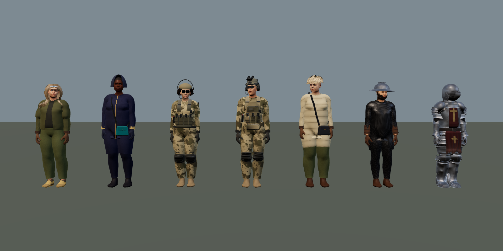

## The pieces

There are 29 garments in `island/src/gameplay/arms.js` (19 are new). Each one's look is in
`island/src/people/armor-looks.js`.

| Slot | Aether | The old kingdoms | Modern |
| --- | --- | --- | --- |
| Head | Wayfarer's Hood, Stargazer Circlet | Kettle Helm (wide brim), Great Helm (closed, eye slit, brass cross) | Ops Cap with headset, Ballistic Helmet (high cut, night-vision mount, headset) |
| Top | Aetherweave Coat, Ranger's Jacket | Gambeson (quilted), Mail Hauberk, Plate Cuirass (breast and back plate, fauld, pauldrons) | Combat Shirt, Chest Rig, Plate Carrier |
| Legs | Aetherweave Trousers, Ranger's Trousers | Mail Chausses, Plate Greaves (cuisses, knee cops, greaves) | Combat Trousers with knee pads |
| Hands | Spellbinder Gloves, Fieldcraft Gloves | Plate Gauntlets, Leather Bracers | Tactical Gloves (knuckle guard) |
| Feet | Trailstrider Boots, Duskwalker Boots | Sabatons, Riding Boots | Combat Boots (coyote) |

Modern gear is multicam, with no real makers, insignia or unit marks.

## What it does

The stats for each piece are in `gear-levels.js` STATS. `composeMods` (`magic/stats.js`) folds them into
`state.mods`.

- **Armour**: each piece takes a share of the damage you take. The share grows with the item's level, up to its
  cap. The total is capped at 60%.
- **Weight**: you carry 8 kg for free. Each kilogram over that makes you 1% slower and lowers your jump. The most
  weight can slow you is 30%.
- **Steel and spells**: steel lowers the power of every spell (Spellcraft, shown as −N%).
  - A full knight's kit is 27 kg, so you move 19% slower, and your spells lose 21%.
  - Modern gear has no spell penalty and is light: a plate carrier is 9 kg for 14% armour.
- **Where it shows**:
  - the Character sheet has a Load line;
  - the skills menu shows steel as a red `−N%` chip in each spell's power sources.

## How it is drawn

`dressInGear(style, worn)` lays each worn piece over the clothes you already have on. Each slot replaces only its
own part: a helm takes the place of a cap, and trousers take the place of trousers.

The pieces are built in `people/garment.js` `accessoryGeometry`.

### The knight: dark, worn, fitted plate

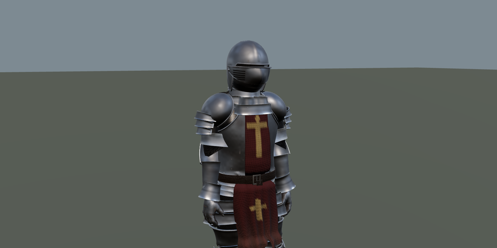

The second pass (2026-10-17) rebuilt the primary forms so the untextured silhouette already reads as a fitted suit.
The before and after sheets are in `verification/armor/compare-*.png`, rendered with the same camera, pose, exposure
and light.

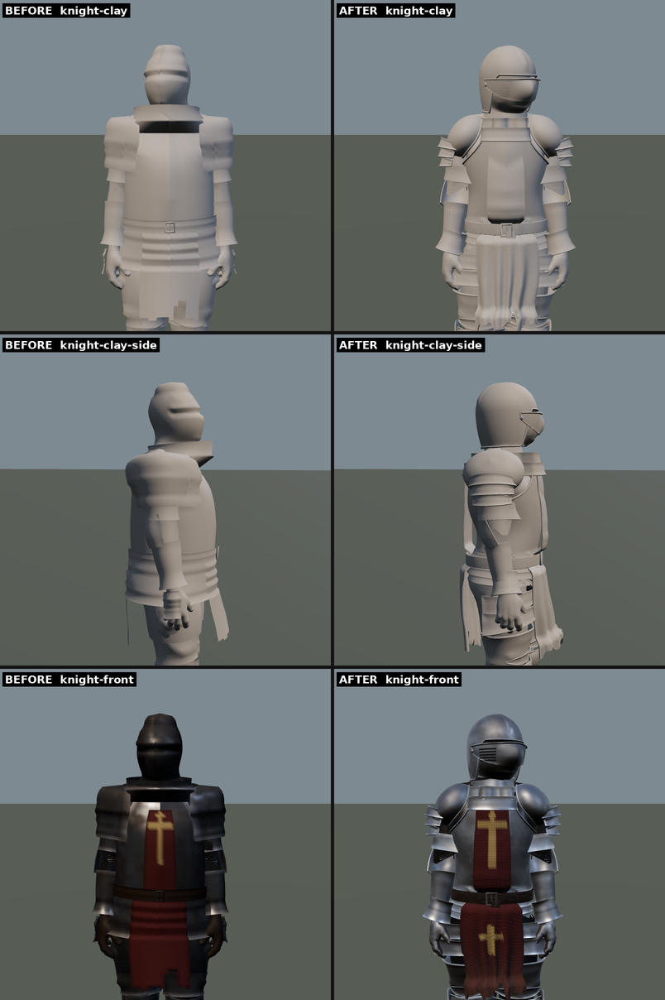

- **Fitted shells** (`fitTube`): each plate is measured round its own axis (the torso, a bone, the head) against
  the skin and the clothes under it, smoothed into broad curves, then stood off by the plate's thickness.
  `press()` then pushes the cloth under a plate inside it, so shirts and padding no longer poke through.
  - **Cuirass**: a designed breastplate with a ridge down the middle, a taper into the waist, cut-away arm openings,
    a backplate and a rolled edge. The fauld lames are worked out from the plate above (`lameR`), so each one laps
    the next by the same amount and the cloth between them is pressed under the innermost plate.
  - **Belt**: its radius is the smoothed largest radius of the plate and tabard across its width, so it no longer
    steps where the breastplate ends.
  - **Pauldrons**: a cap shaped round the shoulder joint with overlapping lames below it; each lame is weighted a
    little more to the upper arm than the one above, so they fan as the arm lifts.
  - **Great helm**: an egg-shaped skull with a comb down the crown; a visor drawn forward to a beak, its upper edge
    flared over the sight, breaths punched in the right cheek, and pivot rivets; a bevor carrying the beak's line
    down to the throat, tucked under the visor; a padded lining seen through the openings; a three-lame gorget.
  - **Gauntlets**: a vambrace measured from the bare forearm and pressed over the sleeve, a flared cuff, and a
    couter shared half and half between the upper and lower arm.
  - **Greaves**: knee cops shared half and half between thigh and shin, with lames weighted 80/20 above and below.
- **A torn tabard** over the plate with a sword device, belt compression and a ragged hem.
- **First person**: steel gauntlets now draw as plate in your own view as well (`sleeve.js` pattern `plate`): a
  steel vambrace with a ridge, rolled top and strap over a mail cuff, and steel knuckles, matching third person.

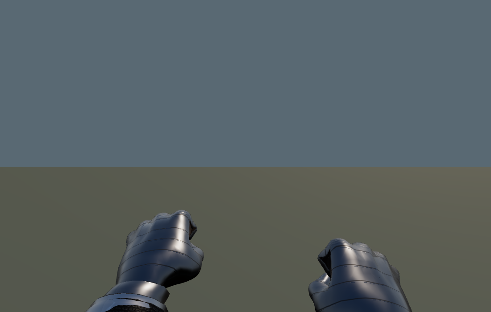

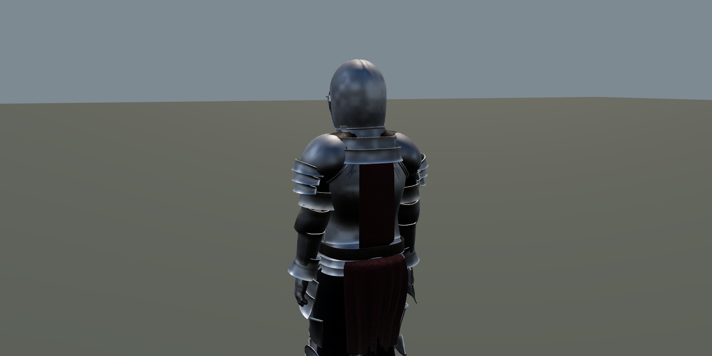

### Modern kit

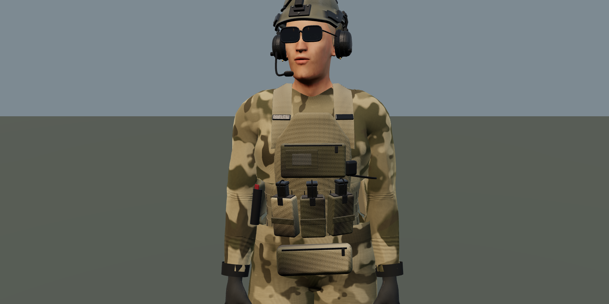

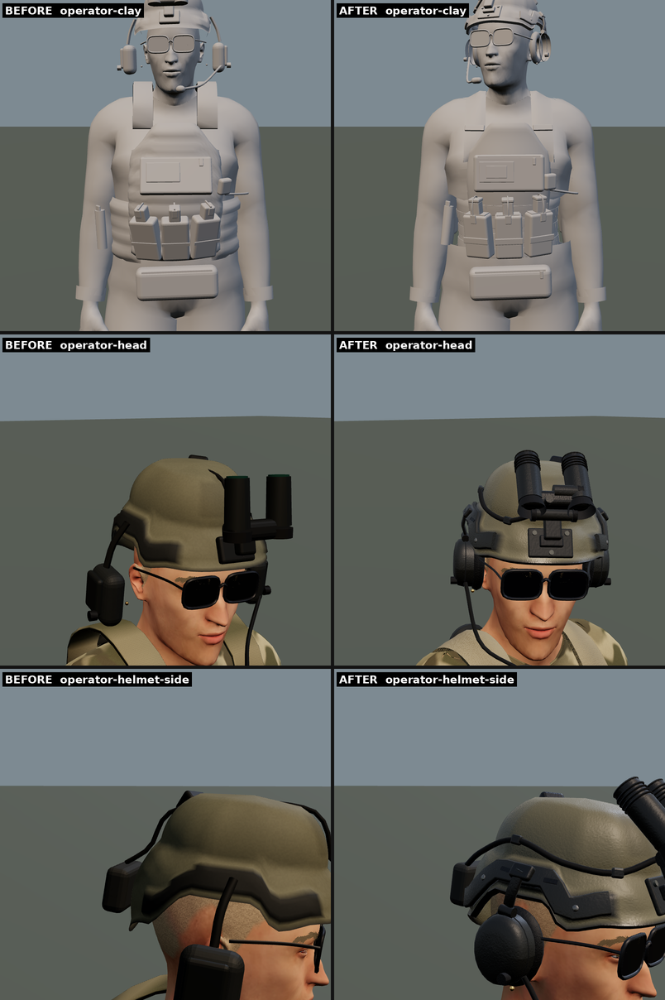

- **Ballistic helmet**: a thick polymer shell (no more bright metal chips on its rim), a rubber edge trim, and
  side rails with bolts and slots.
  - **The black split** at the front came from the night-vision cable lying flush over the crown. The cable now runs
    down the left side in clips.
  - **Night vision**: a shroud with bolts, a mount arm and hinge, and a binocular body with housings, eyecups,
    focus rings and recessed green lenses, plus a battery pack behind and a strobe.
- **Headset**: each cup is found from the actual ear on that body, so it sits on the ear. It has a leather cushion,
  a seam, a knob and a pivot. On the helmet each cup hangs from a rail adapter by a strap; a boom runs from the left
  cup to the mouth.
- **Plate carrier**: padded nylon plate bags measured from the body and pressed onto the shirt, rows of webbing with
  bar tacks, cummerbunds and shoulder straps that hold the shirt under them.
  - **Magazine pouches**: a mouth, elastic band, bungee and pull tab, with the magazine and its base plate standing
    clear of the fabric.
  - **Admin, dangler, radio and medical pouches** are rounded boxes with worn edges and seams.
- **Chest rig**, multicam and ranger green as before.
- **Knee pads**: a padded sleeve with a separate hard cap, straps that press the trousers, and a blend between thigh
  and shin so the pad holds in a crouch.

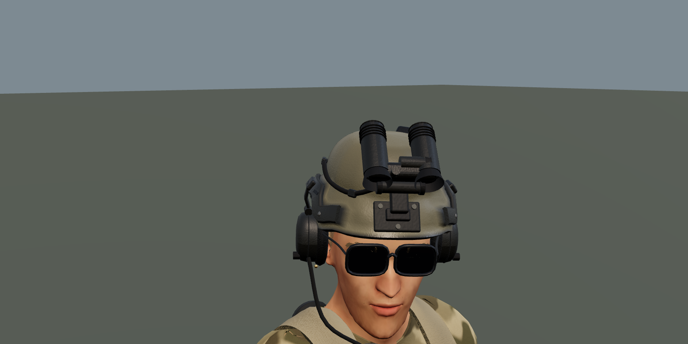

### Materials and light

- **The sky in steel** (`people/kit-light.js`): the world had no environment map, so steel had nothing to reflect.
  A pale sky, bright horizon, dark ground and the sun are made once into a 128 px prefiltered map and given to the
  kit material and the first-person plate gloves. Only the reflections use it; its strength follows the time of day
  and drops indoors and underground.
- **Each material reads differently** (kit gloss in `propkit.js`): exposed steel is metallic with polished edges and
  grime in its recesses; painted metal, rust, leather, nylon (woven, soft), rubber, polymer and glass each have their
  own roughness and colour response.
- **Surface detail** is mapped from each vertex's rest position, so it stays put on the body as you move. Edge wear
  and cavity dirt come from a per-vertex wear attribute.

### Cost

Measured in the preview (`armor-browser.cjs`, which writes `stats.json`) against the build before this pass (3c6ea1d),
with the same people, poses and cameras. "Phone" is the same page with a phone's user agent, so it builds the lighter
phone kit.

| | Before | After |
| --- | --- | --- |
| Knight kit triangles, desktop | 24,700 | 136,500 |
| Knight kit triangles, phone | 15,700 | 50,200 |
| Operator kit triangles, desktop | 31,500 | 64,400 |
| Operator kit triangles, phone | 25,800 | 35,800 |
| Militia and soldiers, average, desktop | 21,500 | 39,900 |
| Militia and soldiers, average, phone | 17,900 | 24,700 |
| Draw calls (a person's whole kit is one mesh) | 76 for the 9-strong militia scene | 76, unchanged |
| Textures | no texture files | no texture files, plus one shared 128 px sky map (about 1.5 MB on the GPU) |
| Build time on phone settings, knight / operator / militia average | 0.62 s / 0.42 s / 0.23 s | 1.0 to 1.2 s / 0.6 to 0.7 s / 0.25 s |

- **Detail levels**: phones get half the segments round each piece, no inside faces or wall thickness, fewer fauld
  lames and simpler rivets and lenses. A rigid plate draws its inside only near its edges, where it can be seen, and
  a fauld lame has only as many rows as its own band needs. Kit is hidden beyond 90 m.
- **Sharing**: every person's kit uses the one shared kit material, and the sky map is made once.
- **Not measured**: GPU frame time. The test browser draws on the CPU, so its frame times say nothing about a real
  GPU. Build time is also from that machine and was taken once, so treat it as a guide.

### How far this can go

### How far this can go

Everything here is built from code at load time, with no models or texture files. Blender was not available in the
build environment, so there is no offline Blender-to-GLB step yet. The next step to a AAA look is authored models
with painted or scanned PBR textures, loaded as glTF.

When your gear changes, the avatar rebuilds your body in place. The first-person arms rebuild from the new body.

**Multiplayer**: the pose carries `wr`, a short wear code. `net/protocol.js` checks it, and `net/remotes.js`
rebuilds a friend's body when it changes. **The rooms Worker must be redeployed for friends to see your gear.**

## The militia

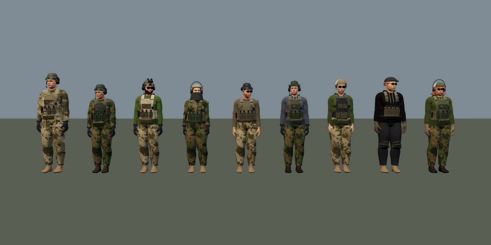

- **Militia**, in `combat/outfits.js` `militia()`:
  - Two in three wear modern kit: a multicam or plain combat shirt, a plate carrier or a chest rig, and a cap or
    a helmet with a headset (some with night vision).
  - Some also wear knee pads, a shemagh and gloves.
  - The rest keep the older camouflage look.
- **Soldiers**:
  - wear night vision more often, and nearly always a headset;
  - often wear knee pads;
  - wear coyote boots with desert or multicam.
- **Armour follows the kit**: `kitArmour(style)` scales a fighter's armour by what they wear (plates, a rig, a
  helmet, knee pads). A fighter in a plate carrier is harder to drop than one in a shirt.

## Checks

- **Tests**: `node --test island/tools/gear-magic.test.mjs` covers the five slots, every piece's look, armour,
  weight, the steel penalty, `dressInGear`, the wear code and the pose check. `military.test.mjs` covers the
  militia's kit and `kitArmour`.
- **Pictures**: `npx esbuild island/tools/armor-preview.mjs --bundle --format=esm --outfile=<b>`, then
  `BUNDLE=<b> OUT=<dir> node island/tools/armor-browser.cjs`. This renders the sets, close-ups and the militia
  with no page errors and no failed shaders.
- **In the running game**: a knight's kit and an operator's kit were each seeded into the save. The game was entered
  and switched to third person. You wear the kit, and there are no errors.

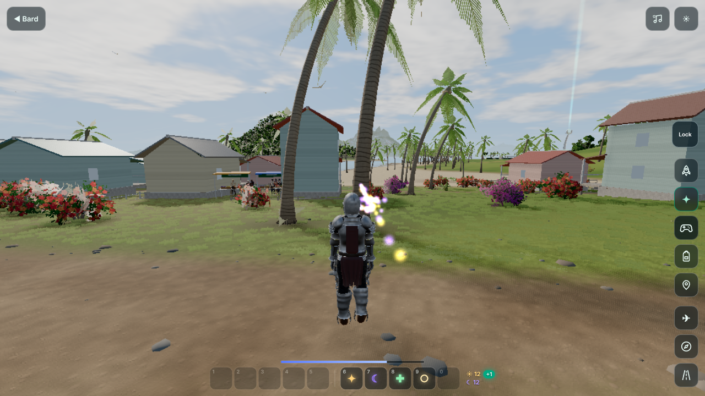

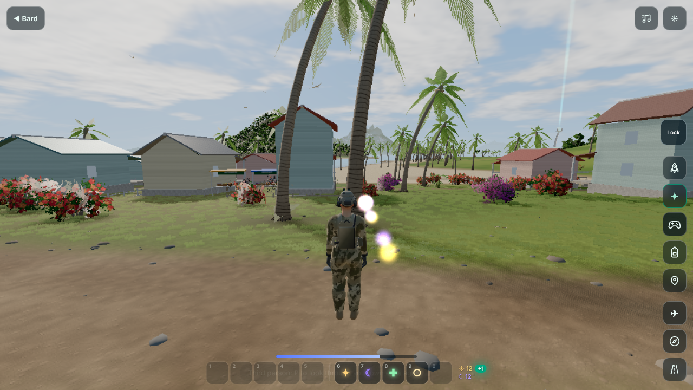

## Not done yet

- **Rooms Worker**: friends see your gear only after the rooms Worker is redeployed.
- **Pauldron caps** still read a little round, and they lift oddly when the arm is raised high.
- **Great helm**: the skull is slightly bulbous, and the gorget has a small notch.
- **GPU frame time** was not measured: the test browser renders on the CPU, so its frame times say nothing about a
  real GPU. Measure on a phone and a desktop before release.
- **Under the hauberk**: where the mail skirt and the chausses meet, a little of the cut shows.
