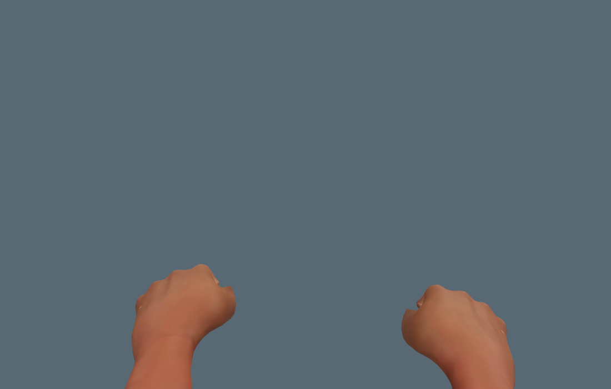
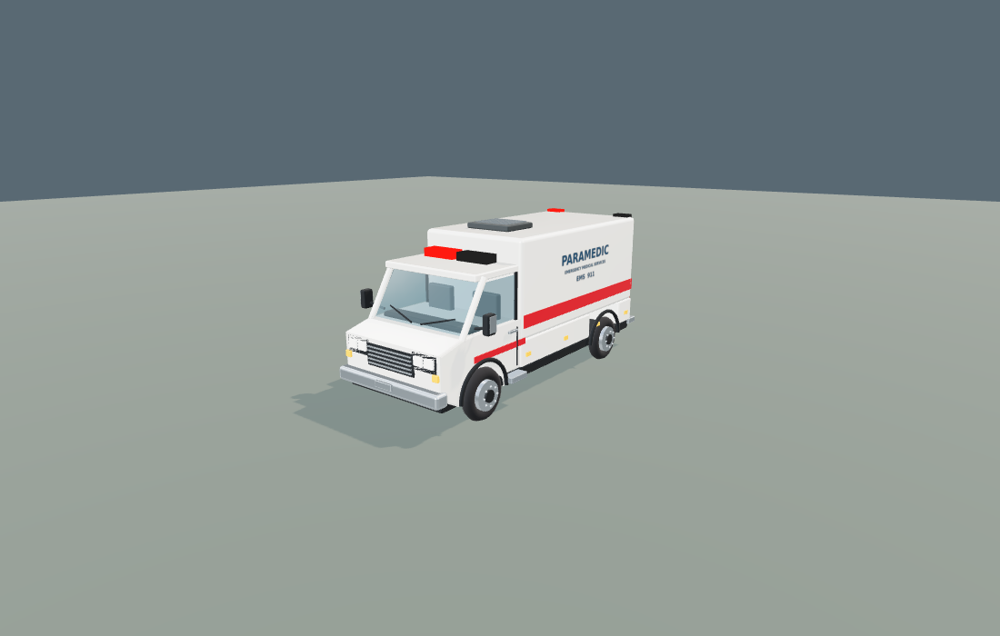
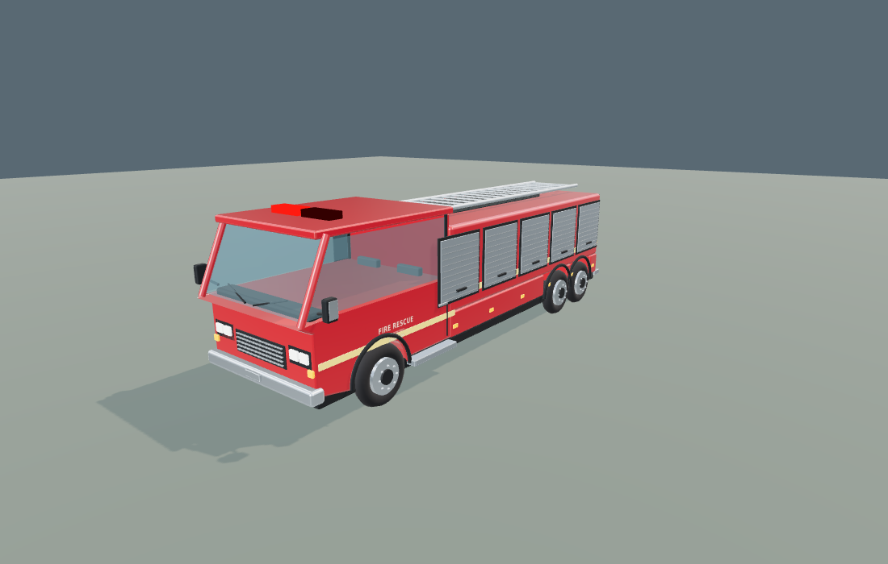
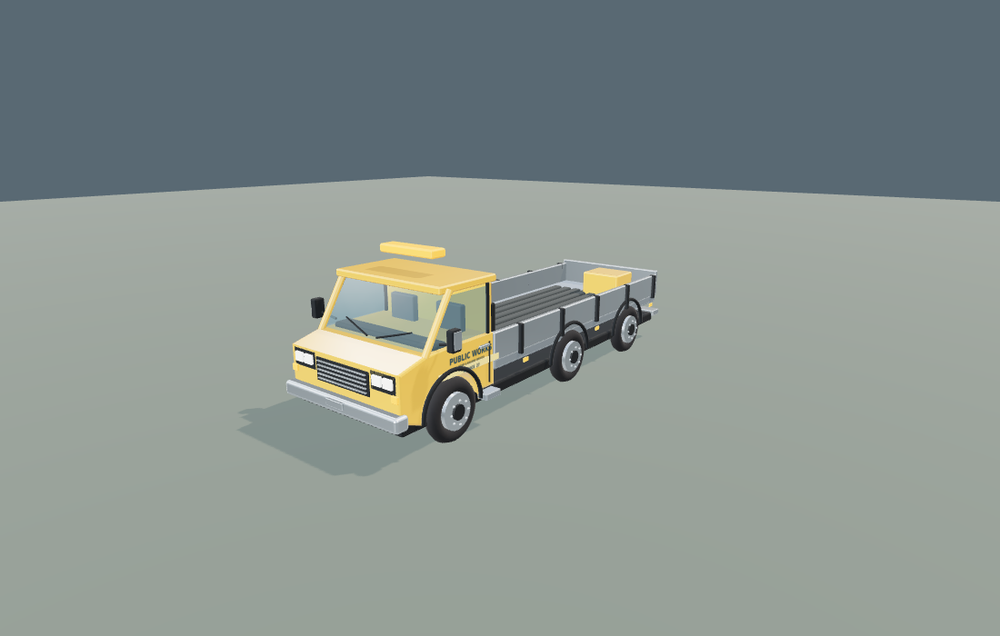

# Anatomical hands and service fleet rendering

The melee view used overlapping primitive shapes, while weapon hands used the player's unrefined body mesh. Emergency units and repair crews used box bodies with little cab, wheel or material detail.

## Changes

- Reuse Bard's existing textured CC0 MakeHuman body for both first-person melee hands, with an independent finger skeleton. Fist, open-hand and carried-item poses preserve the avatar's skin and tattoos without changing its world skeleton or weapon actions. Primitive hands remain a loading fallback.
- Refine only first-person arm/hand triangles with curved edge samples, preserving original contact vertices, UV seams and normalized bone weights. Both phone and desktop first-person skin get filtered pore detail. NPC meshes keep their previous budgets.
- Ambulance, fire engine, public-works truck and glazier van now use shared service models. Shaped cabs and wheel openings, individual glazing and seals, mirrors, seats, grilles, lights, side steps, handles, rims, equipment and markings replace the old boxes. Paint, glass, rubber and metal use separate physical materials. Paint, glass and metal use the existing fleet’s live sky/cloud reflection shader, including day/night and weather uniforms.
- Preserve emergency dispatch, routes, sirens and flashing lights. Active responders rotate their wheels with distance travelled. Repair sites instantiate the same models for trucks and vans.
- Detailed geometry switches to a batched distant model at 55 m with hysteresis. Distant wheels are static; near wheels rotate. Existing rebuild-site distance culling stays in place.

This is a procedural rendering upgrade, not a claim that the game now matches a scanned, commercially authored AAA asset set. iOS hardware frame rate and Safari should still be checked on-device. Scope-glass and weapon mechanics are unchanged.

## Reusable public assets

| Source | Verified license / suitability | Used in this change |
| --- | --- | --- |
| [MakeHuman / MPFB](https://static.makehumancommunity.org/about/license.html) | The standard exported character assets are CC0; third-party contributed assets must be checked individually. Native finger rig and skin textures already exist in Bard. | Existing Bard asset, refined and reused. |
| [Innerscene anatomical hand](https://www.innerscene.com/tools/library/3d-parts/posable-anatomical-right-hand-f6098b4f) | Listed as CC0, 495 KB GLB, 16 named bones, skinned and textured. No animation clips; runtime joint constraints and weapon poses would be needed. | Evaluated as an alternative; not downloaded or bundled. |
| [SparrowHawk Hands Rigged](https://blendswap.com/blend/22269) | Listed as CC0. Left and right hands in Blender format, with an armature; the author explicitly supplies no textures. Needs material work and GLB export. | Alternative only; not bundled. |

Avoid assuming that any downloadable hand is reusable commercially: for example, the anatomical XR hand found during research was explicitly noncommercial. The vehicle geometry in this change is code-authored; there are no new third-party vehicle downloads or runtime CDN dependencies.

## Verification

- Production bundle: `cd island && npm run build`. The normal build updates both engine URLs in `index.html` with the new hash.
- 30 targeted Node tests pass, covering hand weight interpolation, shared vehicle resources, finite/grounded geometry, wheel rotation, melee rules, service dispatch/routes, armament runtime and bow checks.
- Production weapon browser checks: 40 carry/aim/fire/reload/ready states, plus 36 body-size/pitch combinations. Maximum measured grip contact error: 0 mm; no browser or shader errors.
- Hand/fleet browser checks: 22 recorded states spanning desktop and phone-sized Chromium, five melee poses, rifle/bow transitions, all four vehicle types, distance LOD and moving responder wheels. No browser or shader errors. Phone emulation is not an iPhone hardware benchmark.
- The sample avatar uses 13,540 triangles per melee hand/forearm. The complete weapon arm layer is 27,848 triangles including sleeves. Four melee draw calls: two skin and two sleeve meshes.
- Near fleet renders in the isolated verification scene range from about 20k to 34k submitted triangles including shadow rendering. Distant models are around 1k to 1.4k. Shared cached geometry is not disposed when an individual unit or repair site is removed.

Artifacts: [render report](verification/hand-service-rendering/report.json), [unit tests](verification/hand-service-rendering/tests.txt), [weapon report](verification/hand-service-rendering/weapons/report.json).






Browser checks can be reproduced with a local Chromium and Playwright:

```sh
cd island
node_modules/.bin/esbuild tools/weapon-hand-preview.mjs --bundle --format=esm --outfile=dist/weapon-hand-preview.js
node_modules/.bin/esbuild tools/service-hand-preview.mjs --bundle --format=esm --outfile=dist/service-hand-preview.js
node tools/weapon-hand-browser.mjs
node tools/service-hand-browser.mjs
```

`CHROME_EXECUTABLE` and `PLAYWRIGHT_MODULE` can point to an installed browser and Playwright module. Preview bundles are disposable verification outputs and are not part of the shipped app.
