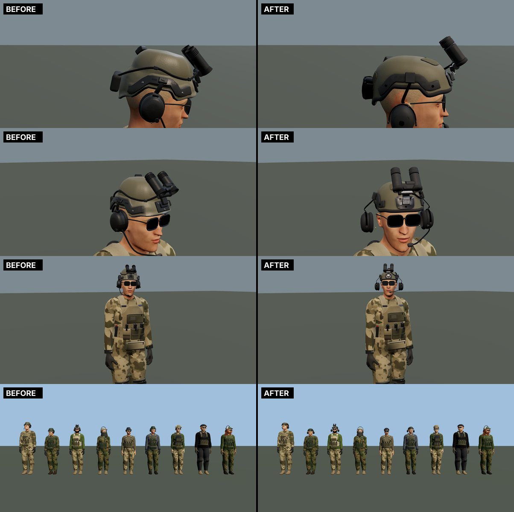
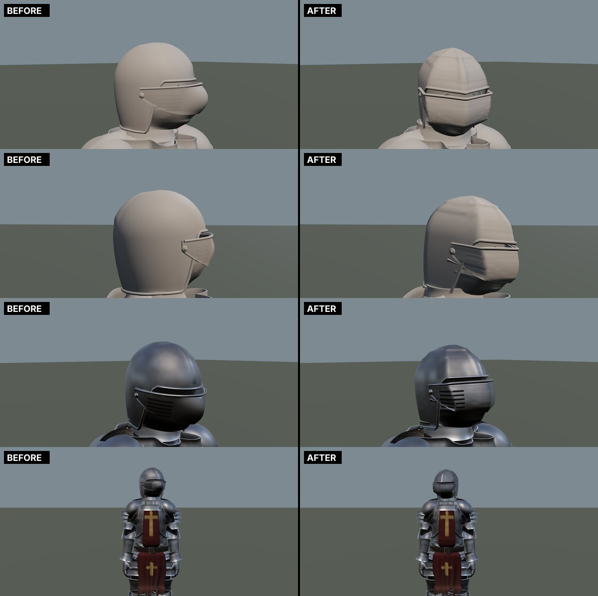
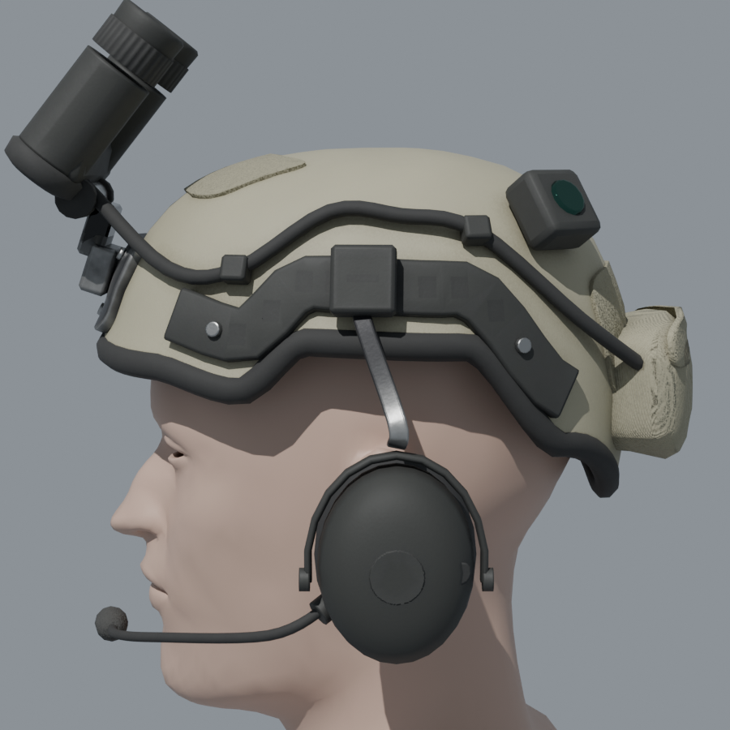
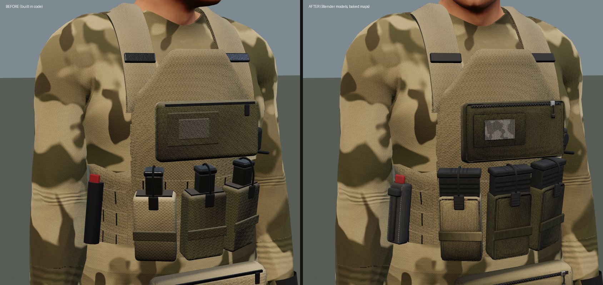
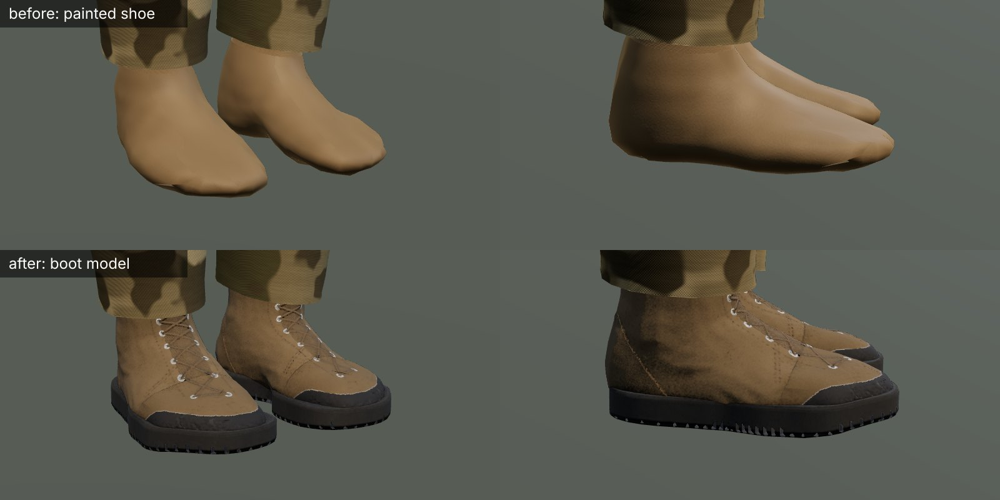
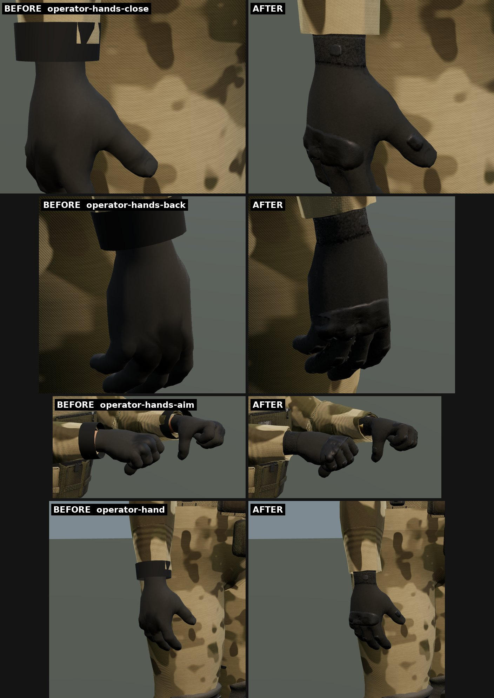
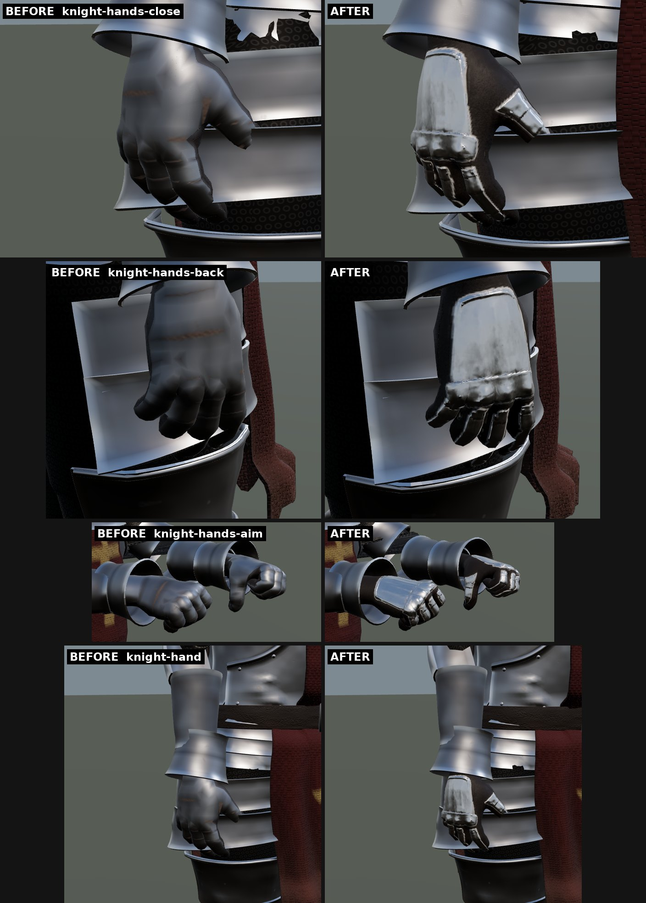

# Soldier kit as real 3D models, and a forged great helm (October 18, 2026)

## What changed

- **Soldiers' head kit as real models.** This covers three pieces:
  - The high-cut ballistic helmet: shell, rubber edge trim, side rails, front shroud and loop panels.
  - Night vision stowed up on its mount, with the battery pouch behind it, its cable and a strobe.
  - The electronic headset on the rails, with a boom mic on the left cup.

  Each piece is modelled twice in Blender: a light game mesh, and a detailed copy (bevels, rail windows, screw heads, ribbed focus rings and knobs, grit, weave). The detailed copy is baked into one 2048 atlas:
  - colour;
  - tangent-space normals;
  - occlusion, roughness, and metal or the wearer's colour.

  The game fits each piece to each head and lays it into the person's existing kit mesh, so it is still one draw per person. The painted parts take the helmet's own colour.
- **Knight's great helm.** It now sits tight to the head and is forged in hard planes instead of a round shell:
  - six facets per level, creased down the front and back and at the cheeks;
  - a keel over the crown;
  - a heavy brow over the sight;
  - a visor that comes to a beak.

  This is Josh's "Greek proportions, too round and soft and balloon" ask. The code is `closeHelm` in `people/garment.js` (`facet()`).

## The plate carrier's kit (second batch)

The carrier's pouches and fittings are now real models too, baked into the same atlas as the head kit:
- magazine pouches, each with its magazine standing out of it (ribbed body, base plate with grip ridges), the elastic band, the shock cord over the base plate and its pull tab;
- the admin pouch with its loop field, a subdued patch, the zip along its top and its pull;
- the dangler under the front plate, seamed, zipped;
- the radio in its pouch, ribbed, with its two knobs and the antenna's socket;
- the push-to-talk switch on the strap, with its ribbed button;
- the medical pouch with its bound flap, red pull tab and loop field;
- the folded tourniquet with its windlass, clip and red tab;
- the zip-on back panel, with rows of webbing and bar tacks, a loop field and zips down its sides;
- the drag handle with its rubber grip, and the ladder-lock buckles on the shoulder straps.

The carrier's plate bags, cummerbund and straps are still made to each body in code (they have to follow the body), and the antenna and the radio's cable are still drawn in code too. `garment.js` `putPart` lays each model in the same frame as the old pieces (its back on the surface at the point it hangs from, +z out), so the old procedural pieces are still the fallback if the files do not load. The pouches take the wearer's colours and camouflage, and the magazines take the magazine colour.

## Combat boots (third batch)

Soldiers' and militia combat boots are a real model now, where before they were the shoe painted on the foot's skin:
- a moulded rubber sole with a toe spring, lugs underneath and blocks round its wall;
- a rubber rand over the toe, suede toe cap and heel counter (each standing a little proud, stitched round), the quarters in a fine cordura, the tongue;
- eyelets up the front with the laces crossing over the tongue, a padded collar and a pull loop.

The boot is modelled round the reference operator's left foot (`island/tools/blender/ref-foot.obj`, in the foot's frame: origin at the ankle joint, +z along the foot, +x out to the side). It was made in Blender by closing the foot and ankle, standing them off, voxel-remeshing and smoothing them, then cutting the shaft and the sole. `garment.js` `putBoot` fits it to each foot. It stretches the boot to that foot's length behind and in front of the ankle, its width each side and its depth under the ankle, and the shaft to the shin's girth. It mirrors the boot for the right foot. Each point rides the bones of the skin nearest it, so the boot bends with the foot and ankle. Only shoes marked `combat` get it (`combat/outfits.js` `boots()`, and `combat-boots` in `armor-looks.js`).

Under the boot the cloth shoe stands only 3 mm off the skin, like a sock, so it never shows through. The zone edges (rand, toe cap, heel counter, tongue, collar) are planes cut into the mesh, and each overlay is its own sheet closed down to the surface by a lip, so the edges run straight instead of stepping along the remeshed faces. The toe box is smoothed harder so the toes don't show.

Every kit piece now carries one UV layer of one name. Before, pieces modelled with their own UVs and pieces given projected UVs joined into two layers, and the game read the first, so some faces of the helmet, headset, pouches and the boot's collar sampled the atlas's corner.

## Combat gloves (fourth batch)

Soldiers', militia and operators' combat gloves (`combat: true` in `combat/outfits.js`, and the `tactical-gloves` look) now carry baked detail:
- a moulded knuckle guard over the four knuckles, rising on each and flexing between them;
- pads over each finger's middle joint and the thumb's;
- a synthetic suede palm and fingertips, a stretch back, stitched seams along the fingers;
- a ribbed cuff with a hook-and-loop strap round the wrist, its tab and a moulded pull.

The glove is still the hand's own skin stood off 3.5 mm, so it bends with every finger as before. The detail is baked onto that skin: `ref-hand.obj` is the reference operator's left hand and the start of the forearm, as the body's own faces, so the same faces exist on every body. `soldier-kit.json` `glove` lists, for each hand, those body faces and the atlas at each of their corners. The right hand's faces are matched to the left's mirror, so both share the same texels. `garment.js` `gloveShell` takes the face list in place of its own cut when the kit is loaded. The flat strap that the sleeve's camouflage showed through is gone for these gloves. The guard and pads are a rubber in the glove's own colour, so no pale seam shows where the tint changes.

Zone edges (back and palm, fingertips, cuff) are cut into the surface along each field's level line (`iso_cut`), and the seams' stitches follow those lines.

## The knight's gauntlets (fifth batch)

The knight's plate gauntlets (`plate-gauntlets`, `steel: true`) are now a real gauntlet baked onto the hand the same way as the combat glove, from a table of their own (`soldier-kit.json` `gauntlet`: the same body faces, its own texels):
- a glove of leather in the set's leather colour, stitched down each side;
- a fluted plate over the back of the hand, its wrist end rolled, riveted at its corners;
- a knuckle plate with a boss over each knuckle, lapping over the back plate;
- two scales over each finger's first bone, one over the second and a pointed cap on the tip, each lapping over the next, the first riveted at its sides;
- two scales and a cap down the thumb.

Unlike the glove, the gauntlet's shell stands further off where the plates are: the table carries a lift for each corner (in twentieths of a millimetre, up to about 4 mm), so the hand has the plates' bulk in silhouette as well as in its shading. The steel is baked as metal (not tinted); the leather takes the set's leather colour. The vambrace, the bell cuff over the wrist and the couter are still made in code.

The plates are grids bent onto a rounded rectangle and laid on the glove by rays from above, then smoothed into a sheet over the knuckles' bumps but never sunk under them (`plate`). The finger scales are found by rays out from each finger's bone (`lame`), and the thumb's by rays in from outside, as its bones do not run down its middle.

## How it works

- **Modelling:** `island/tools/blender/soldier_kit.py`, run with Blender as a Python module (`pip install bpy`, Python 3.13).
  - It models to `ref-head.obj`, an operator's head taken from the game, in the kit frame: metres, origin at the skull's middle at eye height, +y up, +z forward.
  - The shell is raycast off that head, stood off it on the pads, and smoothed.
  - Pieces are parametric: the shell grid, swept rails, cables and trim, patches laid on the shell, lathed cups.
  - UVs are in metres and packed into one atlas.
  - Every map except occlusion is baked selected-to-active in Cycles. Occlusion comes from the game meshes and the head.
  - The `preview` argument renders Cycles previews.
- **Packing:** `island/tools/bake-soldier-kit.mjs` writes to `island/assets/kit`.
  - The GLB is quantised and meshopt-compressed.
  - The colour map is lossy WebP and the normal map is lossy q92.
  - The occlusion/roughness/metal-tint map is lossless at 1024. Lossy WebP shares chroma between channels, which bled metal into the rails.
- **Runtime:**
  - `people/kit-models.js` loads the kit with the people's assets. A phone loads the half-size maps (`kit-*-phone.webp`, made by the packer), never decoding the full ones.
  - `garment.js` `putModel` scales each piece from the reference head to this head's width, depth and height over the eyes.
  - The kit material treats id 11 as "read the atlas" (`propkit.js`, `KIT_ATLAS`), with derivative tangents, the green channel flipped for glTF UVs, and baked occlusion on the sky light.
  - If the files fail to load, the old procedural kit is built instead.

## Cost

- **Triangles:** with the head kit, the operator's kit mesh was 63.0k, against 64.4k for the procedural version, and the militia average 40.1k against 39.9k. Draw calls are unchanged.
- **Download:** 1.5 MB in all for the head kit; about 2.3 MB with the carrier's kit (the atlas is shared, so the extra is mostly the normal map's finer weave).

| File | Size |
|------|------|
| GLB | 141 KB |
| Colour map | 174 KB |
| Normal map | 612 KB |
| Occlusion/roughness/metal-tint map | 614 KB |

- **GPU memory:** three 2048 maps with mips are about 50 MB on desktop. Phones load maps made at half size (1024, the ORM 512), about a quarter of that, and never decode the full ones.

## Not done yet

- The plate carrier's bags, cummerbund and straps, and the uniforms, are still fitted in code.
- The atlas is down to 12 px/cm with the boots, gloves and gauntlets; a second atlas would give the next pieces room.
- The rest of the knight's plate (cuirass, pauldrons, vambraces, legs, sabatons) is still made in code.
- There is no chin strap or helmet cover (camouflage) yet.
- GPU frame time has not been measured.
